# Analysis of viral genomes using the Galaxy platform
# **Exercise 2: Quality control and trimming**

Despite the improvement of sequencing methods, there is no error-free technique. A correct measuring of the sequencing quality is essential to identify issues in the sequencing process; thus, this must be the first step in every sequencing analysis. Then, once the quality control is finished, it's important to remove low quality reads, or short reads, which is why a subsequent trimming step is mandatory. After the trimming step, it is recommended to perform a new quality control step to be sure that trimming worked correctly.

## **1. Illumina Quality control and trimming**

<div class="tables-start"></div>

|**Title**| Pre-processing |
|---------|-------------------------------------------|
|**Training dataset:**|  [**PRJEB43037**](https://www.ncbi.nlm.nih.gov/bioproject/PRJEB43037/) - In August 2020, an outbreak of **West Nile Virus** affected 71 people with meningoencephalitis in Andalusia and 6 more people in Extremadura (south-west of Spain), causing a total of eight deaths. The virus belonged to the lineage 1 and was relatively similar to previous outbreaks occurred in the Mediterranean region. Here, we present a detailed analysis of the outbreak, including an extensive phylogenetic study. This is one of the outbreak samples.
|**Questions:**| <ul><li>How do I check whether my Illumina data was correctly sequenced?</li><li>How can I improve the quality of my data?</li></ul>|
|**Objectives**:|<ul><li>Perform a quality control on raw Illumina reads.</li><li>Perform a quality and length-based trimming on raw Illumina reads.</li><li>Perform a quality control on trimmed Illumina reads.</li></ul>|
|**Estimated time**:| 25 min |

<div class="tables-end"></div>

### **1.1. Quality control**

#### **1.1.1. Upload data**

To run the quality control over the samples, follow these steps:

1. [**Create a new history, as we explained yesterday**](https://github.com/BU-ISCIII/galaxy_virologist_training/blob/one_week_format/exercises/01_introduction_to_galaxy.md#2-galaxys-history) named **Illumina preprocessing**.
2. [**Upload data as seen yesterday**](https://github.com/BU-ISCIII/galaxy_virologist_training/blob/one_week_format/exercises/01_introduction_to_galaxy.md#3-loading-data), copy and paste the following URLs:

```
ftp://ftp.sra.ebi.ac.uk/vol1/fastq/ERR531/002/ERR5310322/ERR5310322_1.fastq.gz
ftp://ftp.sra.ebi.ac.uk/vol1/fastq/ERR531/002/ERR5310322/ERR5310322_2.fastq.gz
```
FASTQ files will be uploaded as **.fastqsanger.gz** files, which is a way Galaxy has to identify FASTQ files which follow the Phred+33 encoding.

3. You can add some tags to the files. _**It is mandatory that the tag starts with `#` to be propagated to the processes**_.

</p>

#### **1.1.2. Run FastQC**

1. Search for the **FastQC** tool in the left panel.
2. Select **FastQC - Read Quality reports**.
3. Select multiple datasets in Raw read data from your current history.
4. Select the two datasets (R1 & R2).
5. Then go down and select **Run tool**.

<p align="center">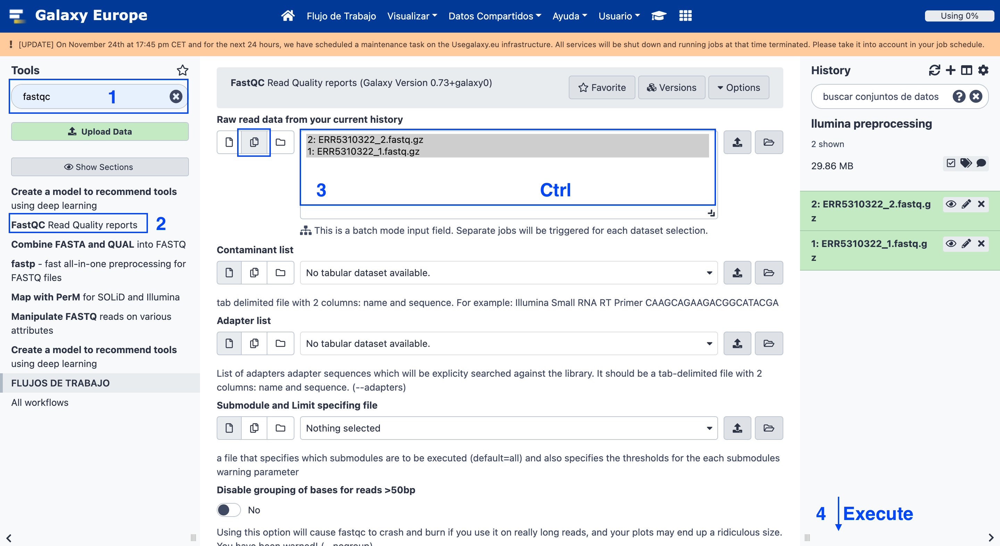</p>

FastQC will generate for each dataset two results: an HTML file with a variety of graphs (**WebPage**) and a TXT file with raw data used for each one of its modules (**RawData**). To see the results, we will open the jobs with **WebPage** in their name for both data 1 and data 2 (click on the **eye icon**).

<p align="center">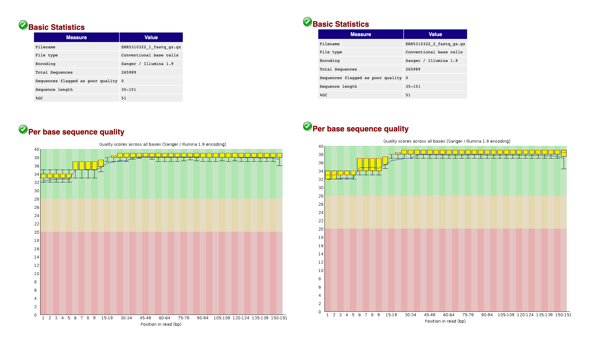</p>

Here, you can see the number of reads in each file before trimming, the maximum and minimum length of all reads in the sample, and the quality plots for both R1 and R2. They look quite good, but we will next perform trimming over these samples.

<details>
<summary>How many reads do these samples have?</summary>
<b>265989</b>
</details>

<details>
<summary>Which tool can we use to check whether our Illumina data was correctly sequenced or not?</summary>
<b>Using FastQC</b>
</details>

### **1.2. Trimming**

Once we have performed the quality control, we can carry on with the **quality** and **read length trimming**:

#### **1.2.1. Run Fastp**

1. Search for **fastp** in the tools.

2. Then select **fastp - fast all-in-one preprocessing for FASTQ files**.

3. Single-end or paired reads > **Paired Collection** (this is for most recent versions of the software; for older versions, you'd be able to select directly "Paired" and load each one of the datasets separately).

> [!WARNING]
> To use this option from Fastp, it is necessary to first create a **list of paired datasets**, given our .fastq files, which will then be used for the rest of the steps of this workshop. In order to do so, we must:
>
> 1. **Select our fastqsanger.gz files that we uploaded in the beginning, and then click on _2 of X selected_**.
>
>    <p align="left">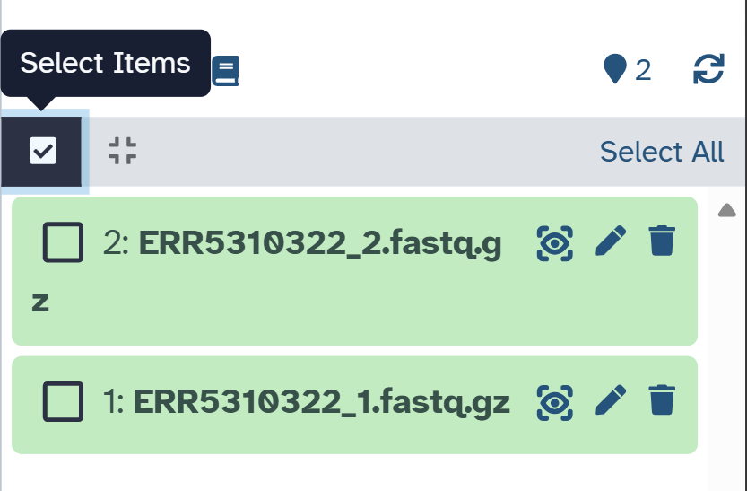</p>
>
> 2. **Select _Advanced Build List_**.
>
>    <p align="left">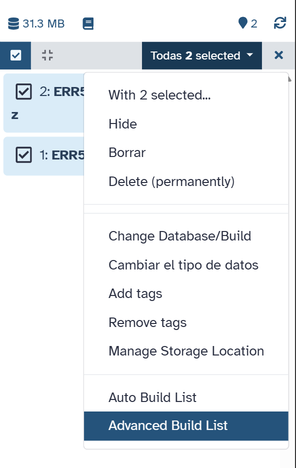</p>
>
> 3. **Select the _List of Paired Datasets_ box and click on *Next***.
>
>    <p align="left">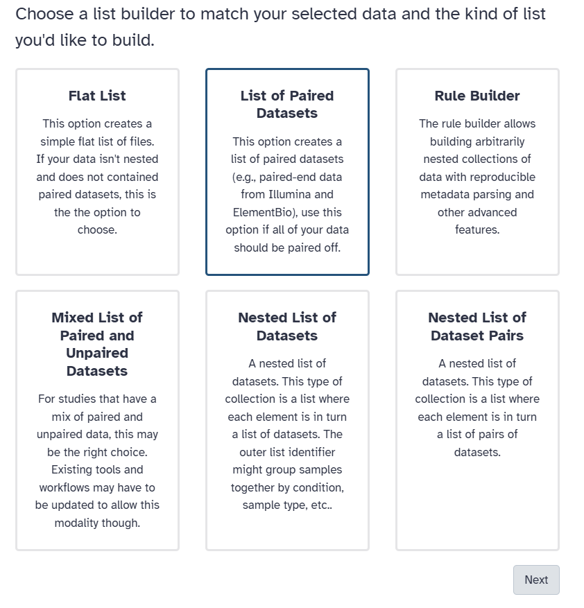</p>
>
> 4. **Check the auto-pairing configuration and click again on *Next***.
>
>    <p align="left">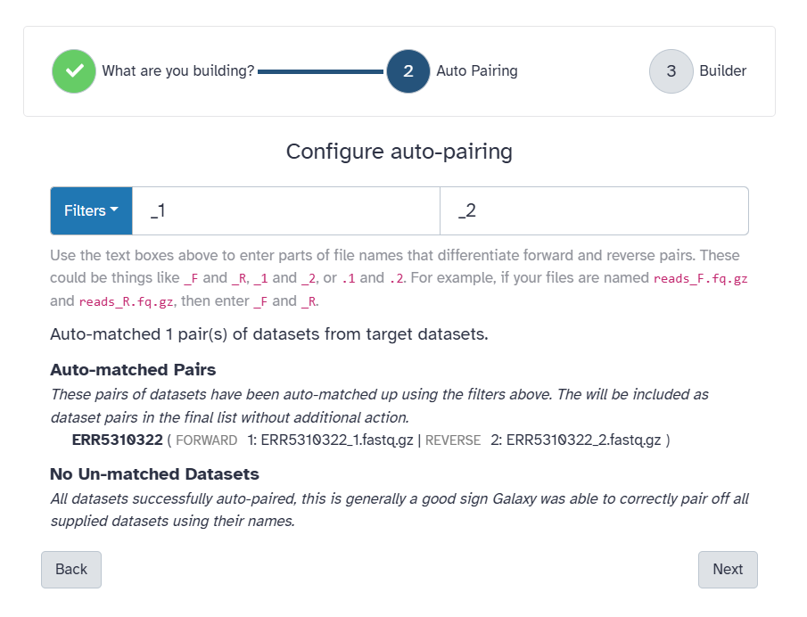</p>
>
> 5. **Give a name to your list and finally click on *Build***.
>
>    <p align="left">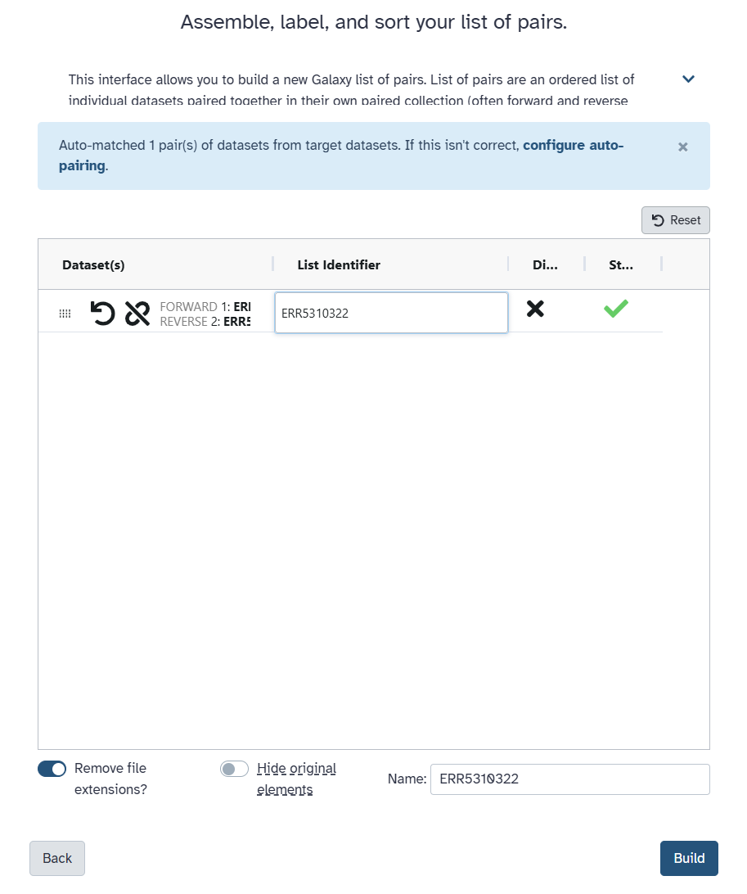</p>
>
> **After having done this, a list of datasets will have been generated:**
>
>    <p align="left"></p>
>    <p align="left">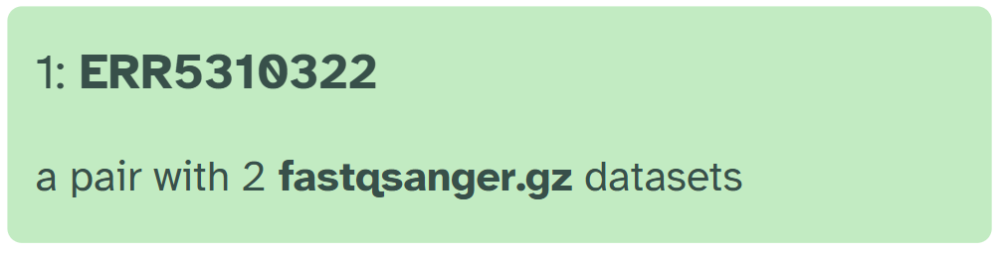</p>
>
> **This list will have the forward and reverse reads:**
>
>    <p align="center">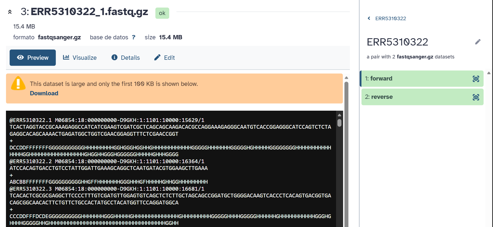</p>
>    <p align="center">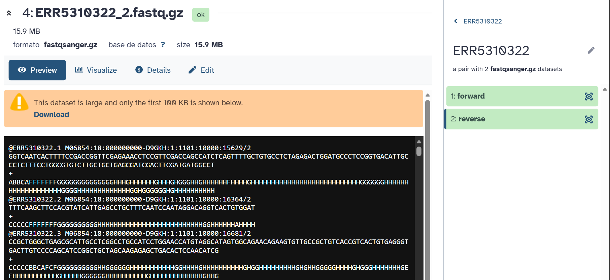</p>
>
> **Once this is done, you'll be able to select your list as input of Fastp.**

1. Display **Filter Options** (for this exercise, we will not provide adapter sequences and we will not trim X bases in front or tail, so ignore the Adapter Trimming Options and Global Trimming Options).
    - **Quality Filtering options**
      - Qualified Quality Phred = **30**
      - Unqualified percent limit = **10**
      - N base limit = - (will be used with its default value (5))
     - Length Filtering Options
       - Length required = **50**

2. **Read modification options**
   - PoliX tail trimming > **Enable polyX tail trimming**
   - Per read cutting by quality options
     - Cut by quality in front (5') > **Yes**
     - Cut by quality in tail (3') > **Yes**
     - Cutting mean quality (for both) = **30**

>[!WARNING]
>There are two sections called "Cut by quality in tail (3')" in Galaxy for fastp. **The first one is the one that should be enabled for this exercise**, since this process takes a sliding window of N bases (4 by default) from the 3' end and removes windows whose mean quality is below the quality threshold, until a window with good mean quality is found.
>
>The other process, on the other hand, is more aggresive, since it takes a sliding window from the 5' end and, if it meets one window with mean quality < threshold, it drops the bases in such window and the whole right part, and then stops. 

3. Finally, click on **Run tool**.

<p align="center">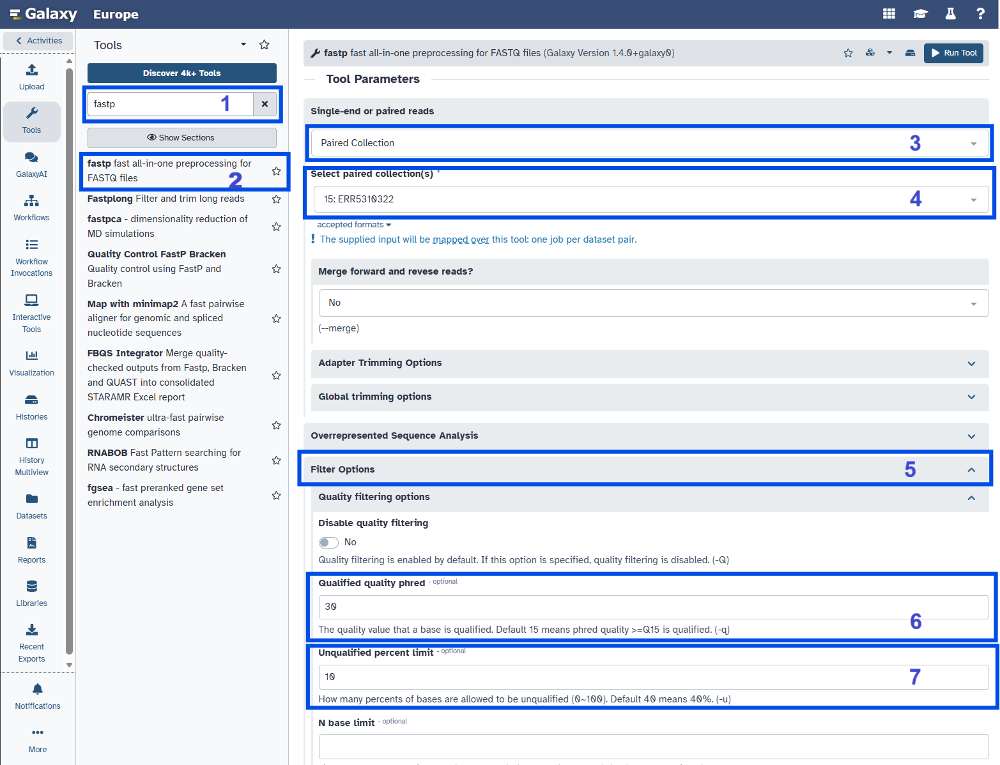</p>
<p align="center">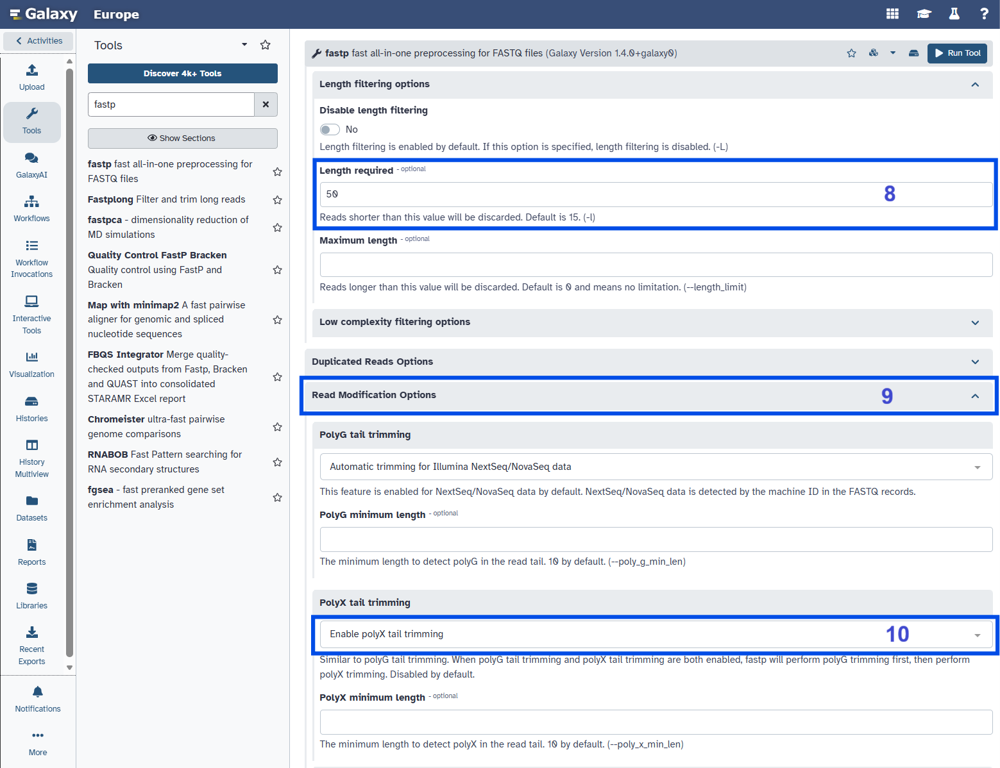</p>
<p align="center">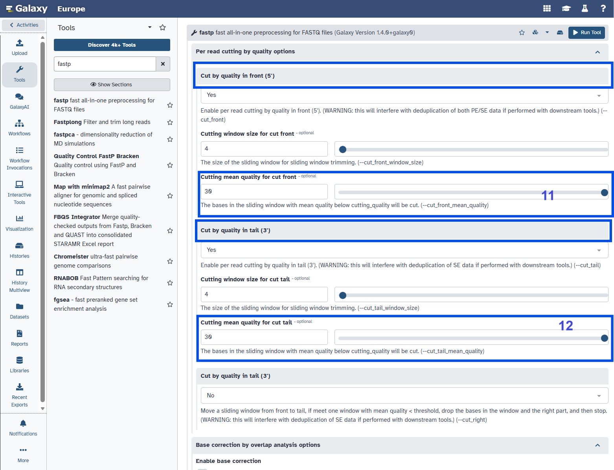</p>
<p align="center">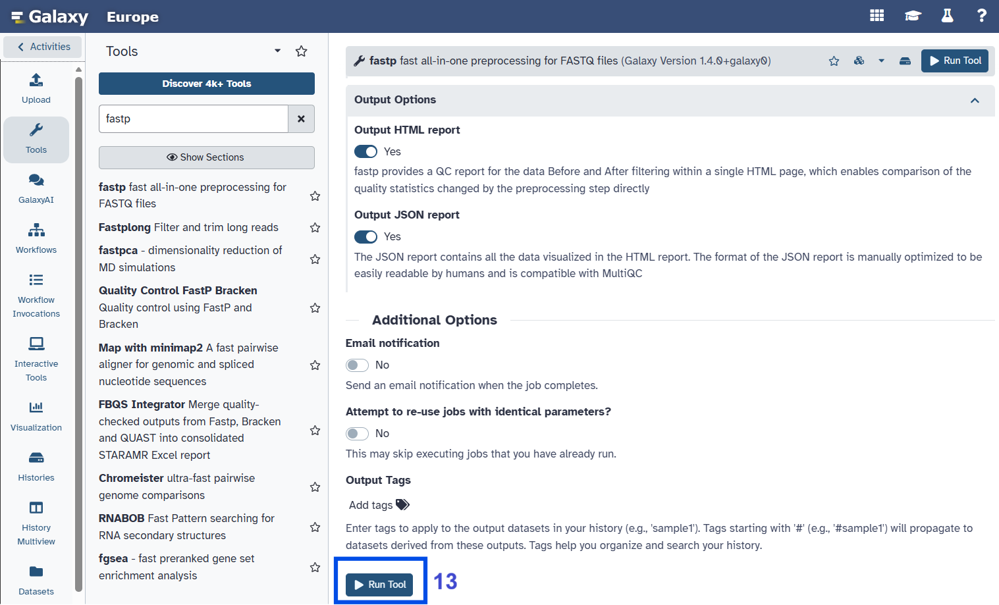</p>

Fastp will generate the trimmed reads along with a report in both JSON and HTML formats. To see the trimming stats, let's take a look at the **fastp on collection X: HTML report** file. You should see something like this:

<p align="center">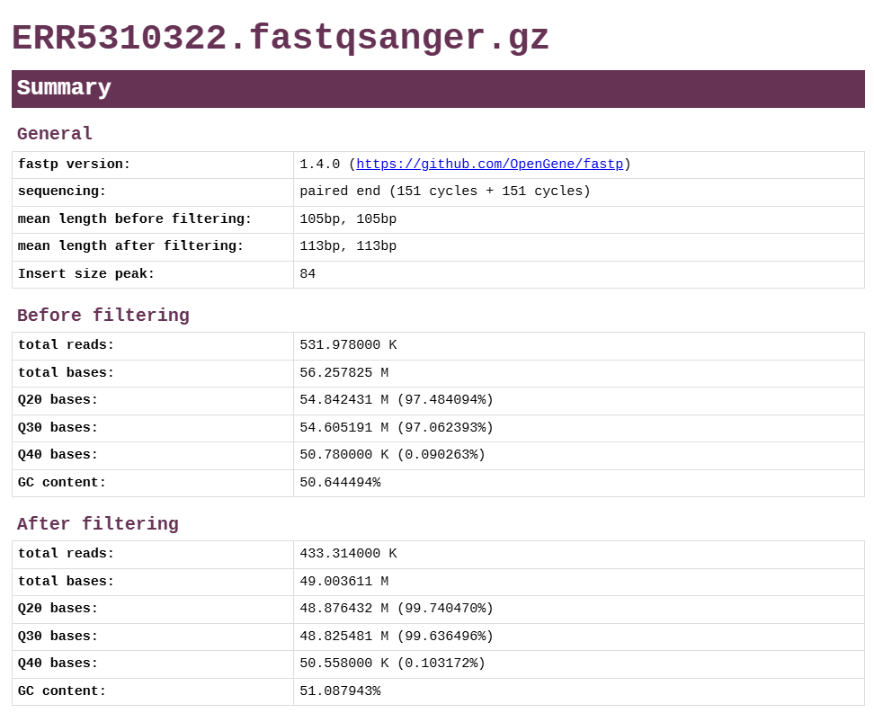</p>

<details>
<summary>How many reads have we lost?</summary>
<b>98664 reads</b> (total reads before filtering - after filtering)
</details>

#### **1.2.2. Other trimming tools: Trimmomatic**

1. Search for **Trimmomatic** in the tools.

2. Select **Trimmomatic - flexible read trimming tool for Illumina NGS data**.
   
3. Single-end or paired-end reads? > **Paired-end (two separate input files)**.

4. Average quality required = **30**.

5. Insert Trimmomatic Operation:
* Select Trimmomatic operation to perform: **MINLEN**.
* Minimum length of reads to be kept = **50**.

6. Select **Run tool**. Trimmomatic will generate paired and unpaired .fastqsanger.gz files for both forward and reverse reads.
   - Two .fastqsanger.gz files (R1-paired and R2-paired) contain reads that survived filtering.
   - Additionally two .fastqsanger.gz files (R1-unpaired and R2-unpaired) contain reads where one of the pair failed the filtering steps.

<p align="center">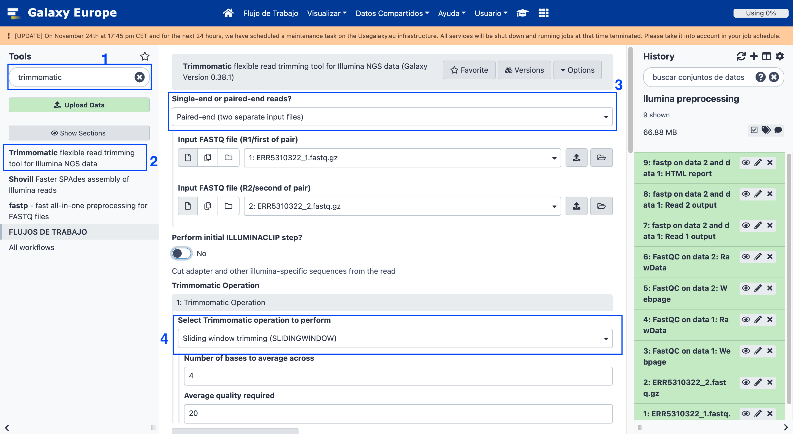</p>
<p align="center">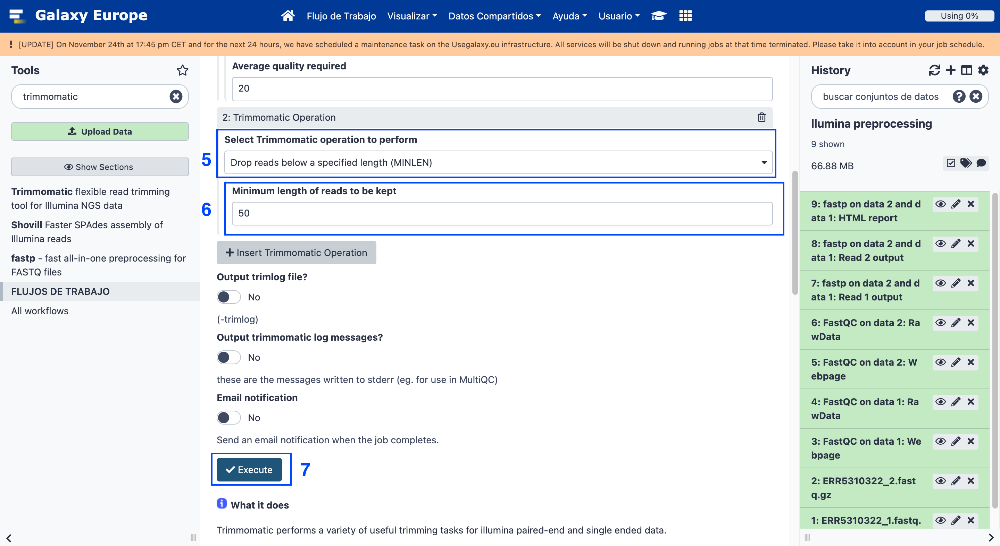</p>

Trimmomatic **does not** perform statistics over trimmed reads, so we need to perform FastQC again over the Trimmomatic results.

<details>
<summary>Try to do it on your own.</summary>
<br>
<p align="center">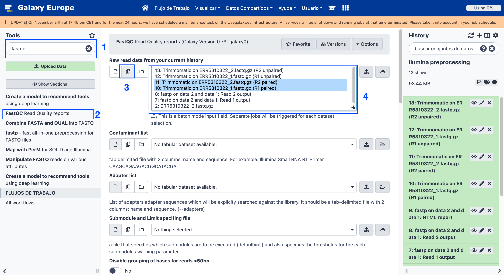</p>
<p align="center">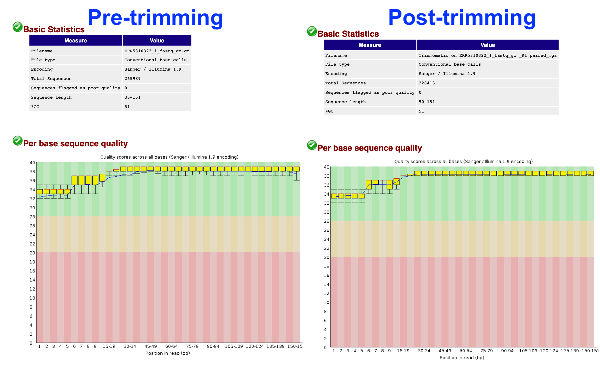</p>
</details>

<details>
<summary>How can we improve the quality of our data?</summary>
<b>Using a trimming software, such as fastp or trimmomatic.</b>
</details>
<br>

>**This hands-on history URL: [https://usegalaxy.eu/u/svarona/h/illumina-preprocessing](https://usegalaxy.eu/u/svarona/h/illumina-preprocessing)**

## **2. Nanopore Quality control and trimming**

<div class="tables-start"></div>

|**Title**| Galaxy |
|---------|-------------------------------------------|
|**Training dataset:**|  The data we will manage now corresponds to Nanopore amplicon sequencing data using ARTIC network primers for the SARS-CoV-2 genome. From the Fast5 files generated by the ONT software, we will select the **PASS** reads, so they are already filtered by quality.
|**Questions:**| <ul><li>How do I know if my Nanopore data was correctly sequenced?</li></ul>|
|**Objectives**:|<ul><li>Perform a quality control on raw Nanopore reads.</li><li>Perform a length-based trimming on raw Nanopore reads.</li><li>Perform a quality control on trimmed Nanopore reads.</li></ul>|
|**Estimated time**:| 15 min |

<div class="tables-end"></div>

### **2.1. Quality control**

To run the quality control over the samples, follow these steps:
1. [**Create a new history has explained yesterday**](https://github.com/BU-ISCIII/galaxy_virologist_training/blob/one_week_format/exercises/01_introduction_to_galaxy.md#2-galaxys-history) named **Nanopore quality**.
2. [**Upload data as seen yesterday**](https://github.com/BU-ISCIII/galaxy_virologist_training/blob/one_week_format/exercises/01_introduction_to_galaxy.md#3-loading-data), copy and paste the following URLs:

```bash
https://raw.githubusercontent.com/nf-core/test-datasets/viralrecon/nanopore/minion/fastq_pass/barcode01/FAO93606_pass_barcode01_7650855b_0.fastq
https://raw.githubusercontent.com/nf-core/test-datasets/viralrecon/nanopore/minion/fastq_pass/barcode01/FAO93606_pass_barcode01_7650855b_1.fastq
https://raw.githubusercontent.com/nf-core/test-datasets/viralrecon/nanopore/minion/fastq_pass/barcode01/FAO93606_pass_barcode01_7650855b_2.fastq
```

#### **2.1.1. PycoQC**

To use PycoQC we need to use the `sequencing_summary.txt` provided by the Nanopore sequencing machine (this file does not contain read sequences, but other relevant information, such as read length, read ID, Phred quality, etc., in this case associated with 9 barcodes (the one sample that we uploaded previously along with other 8)).

[**Upload data as seen yesterday**](https://github.com/BU-ISCIII/galaxy_virologist_training/blob/one_week_format/exercises/01_introduction_to_galaxy.md#3-loading-data), copy and paste the following URL:

```bash
https://raw.githubusercontent.com/nf-core/test-datasets/viralrecon/nanopore/minion/sequencing_summary.txt
```

1. Search for the **Pycoqc** tool.
2. Select **Pycoqc - quality control for Nanopore sequencing data**.
3. In *A sequencing_summary file*: Select the `sequencing_summary.txt` we just uploaded.
4. Select **Run tool**.

<p align="center">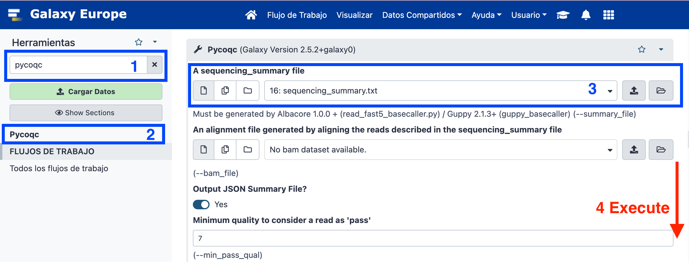</p>

Then we can inspect the resulting **PycoQC HTML Report**:

<p align="center">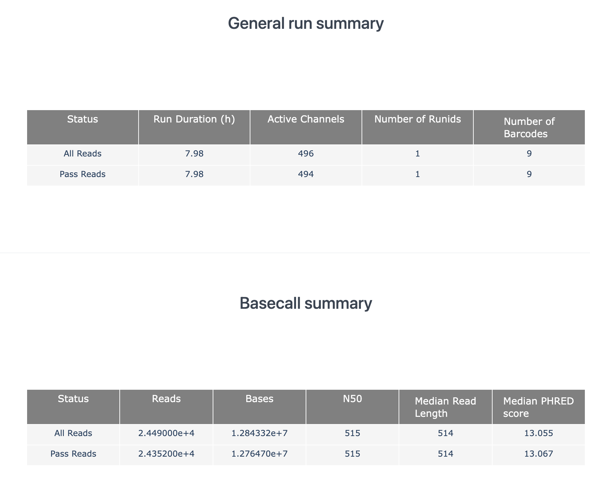</p>

**Questions**
<details>
<summary>How many reads does each sample have?</summary>
<b>~3K reads</b>
</details>

<details>
<summary>Do you understand all the plots?</summary>
<b>Basecalled reads length:</b>
<p align="center">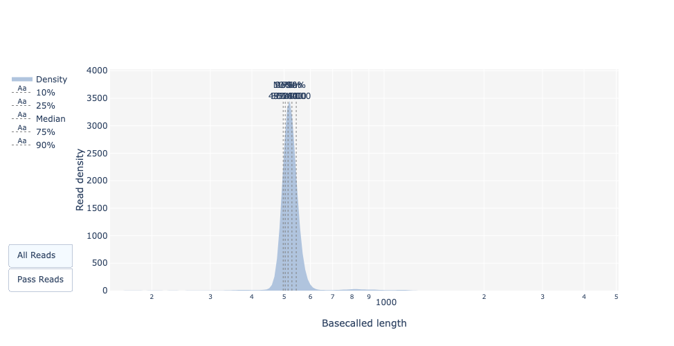</p>

This plot shows the **distribution of fragment sizes** in the file that was analyzed. Long reads have a variable length and this will show the relative amounts of each different size of sequence fragment.

In this example, the distribution of read length is quite dispersed with a minimum read length for the passed reads around 150 and a maximum length ~5000bp.

However, most of the reads are about 500 nt long, as expected by the amplicon experiment.

<br>
<b>Basecalled reads PHRED quality:</b>
<p align="center">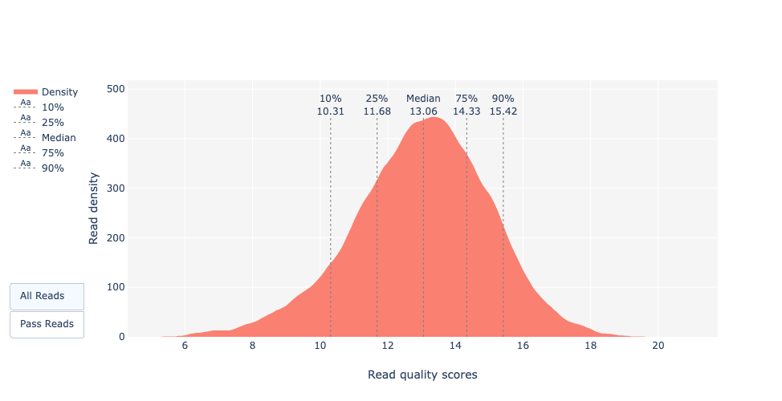</p>

This plot shows the **distribution of per-read PHRED quality scores** (Q-score), with higher scores indicating greater confidence in the base calls.

This score aims to give a global quality score for each read. The exact definition of Q-scores is: the average per-base error probability, expressed on the log (Phred) scale. In case of Nanopore data, the distribution is generally centered around 10 or 12. For old runs, the distribution can be lower, as basecalling models are less precise than recent models.

In our case, the median read Q-score is 13, which means that this run has good quality, since a score of Q13 corresponds to an estimated per-base error probability of approximately 5%.
<br>
<br>
<b>Basecalled reads length vs reads PHRED quality:</b>
<p align="center">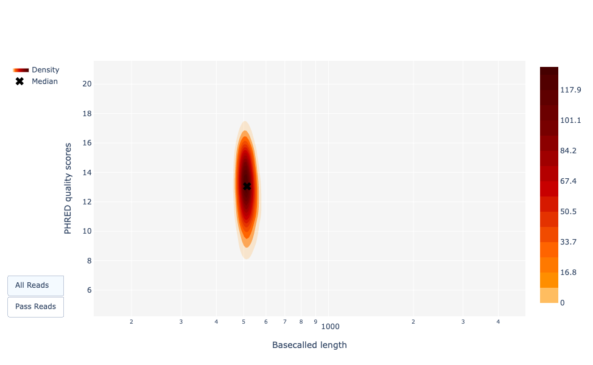</p>

This representation gives a **2D visualisation of read Q-score according to the length**. The main population is concentrated around 500 bp, with a median quality score close to Q13. Reads of similar length span a range of quality scores, showing that a read matching the expected amplicon size does not necessarily have high basecalling quality.
<br>
<br>
<b>Output over experiment time:</b>
<p align="center">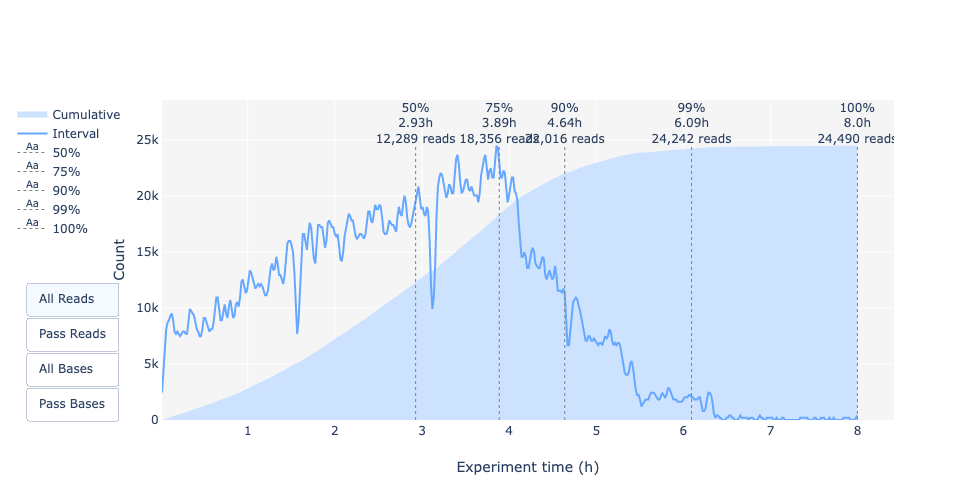</p>

This representation gives information about **sequenced reads over time for a single run**. We can see that the production of reads is decreasing over time, which can be due to the sequencing of most of the genetic material, the saturation of pores and/or the degradation of the material and/or pores.

In this example, the “Cumulative” plot area (light blue) indicates that 50% of all reads and almost 50% of all bases were produced in the first 3h of the 8h experiment. We can see that from 6 to 8h of the experiment, only 200 reads were yielded, which means that we could have ended the experiment 2h before.
<br>
<br>
<b>Read length over experiment time:</b>
<p align="center">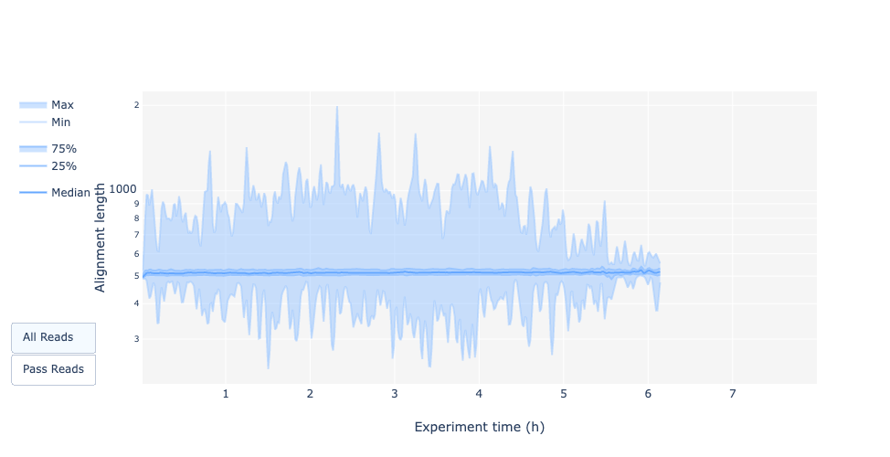</p>
The read length over experiment time should be stable. It can slightly increase over the time as short fragments tend to be over-sequenced at the beginning and are less present over the time. In this case, since almost all the fragments have the same length, the plot is actually constant over time and is consistent with an amplicon library dominated by fragments of similar size.
<br>
<br>
 <b>Read quality over experiment time:</b>
<p align="center">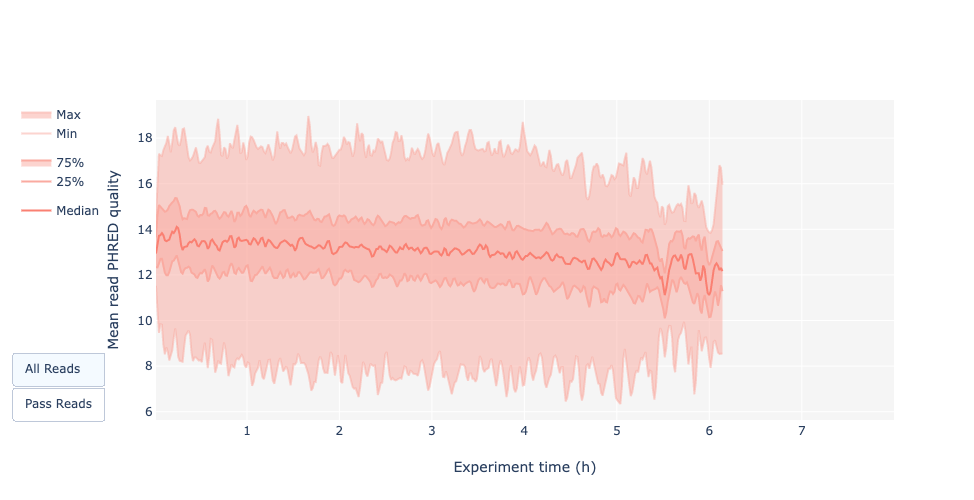</p>
The read quality over experiment time should be stable too, but it usually decreases slightly over time as pores get saturated or degraded. 
In this case, we can see a clear decrease of sequencing quality over the experiment time, but it stays within good quality values, and this can also be fixed with further post-processing of the reads, by filtering lower-quality reads.
<br>
<br>

<b>Number of reads per barcode</b>:
<p align="center">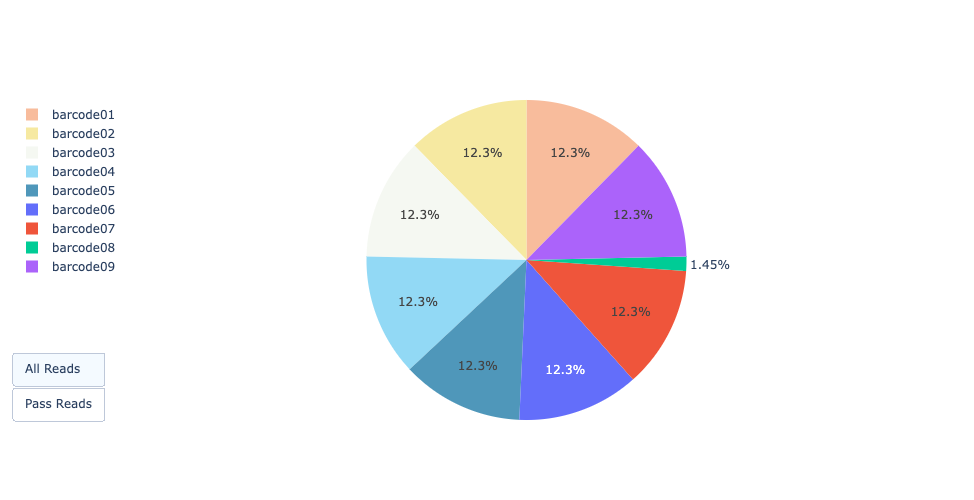</p>

This plot shows the **number of reads per barcode, which means the number of reads per sample to be demultiplexed.**

Eight barcodes have approximately 3,000 total reads each and exactly 3,000 passing reads each. In contrast, barcode08 has only 354 total reads, of which 352 pass the filters.

In a good experiment, all the barcodes should have the same number of reads. In this training, we only use reads from the barcode01 sample, but we can see that barcode08 couldn't be correctly sequenced and is underrepresented.
<br>
<br>
<b>Channel activity over time:</b>
<p align="center">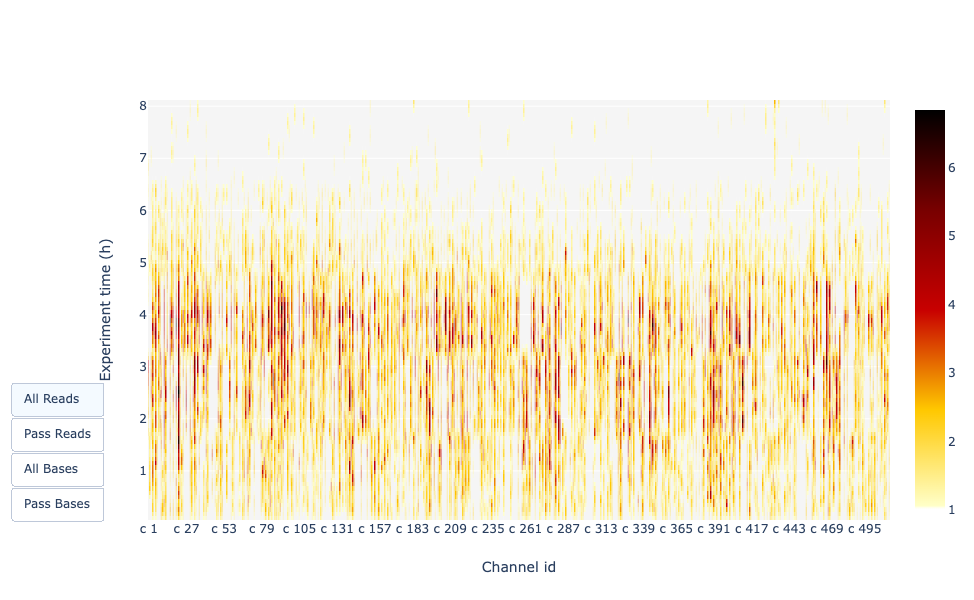</p>

It gives an **overview of available pores**, **pore usage** during the experiment, **inactive pores** and shows if the loading of the flow cell is good (almost all pores are used).

In this case, the vast majority of channels/pores are inactive (white) after the 6h of experiment, so the run could have been finished at that time. 

In this plot, each column represents a sequencing channel, and time progresses upwards along the Y-axis. Darker colours indicate higher sequencing output within each time interval, whereas lighter or white regions indicate little or no output.

Ideally, many channels would show activity at the beginning of the experiment and maintain it over time. A progressive change towards lighter colours indicates declining output. Selecting “Reads” displays the number of reads produced per channel and time interval, while selecting “Bases” displays the total number of sequenced bases.
</details>
<details>
<summary>How can we check whether my Nanopore data was correctly sequenced?</summary>
<b>Using NanoPlot or PycoQC and having a look at the statistic values.</b>
</details>

### **2.2. Trimming**

When Nanopore reads are being sequenced, the **MinKNOW** software splits Fast5 reads into quality **PASS** and quality **FAIL**. As we will select only Fast5 **PASS reads**, we won't need to perform a quality trimming, so even if we see that the reads have a bad Phred score, we know that the ONT software considered the reads as "**good quality**".

Therefore, we will only be performing **read length trimming**. Since we are using amplicon sequencing data, we won't be expecting reads neither smaller than 400 nucleotides, nor higher than 600, which would obviously correspond to **chimeric reads** (sequences from two or more distinct DNA fragments joined together).

#### **2.2.1. ARTIC**

1. Search for **artic** tool.
2. Select **ARTIC guppyplex - Filter Nanopore reads by read length and (optionally) quality**.
3. Structure of your input data: **Multiple input datasets per sample**.
4. While pressing the *Ctrl* key, **select the three samples**.
5. Remove reads longer than = **600**.
6. Remove reads shorter than = **300**.
7. Minimum read quality = **0** (**we had already selected pass reads**).
8. **Run Tool**. ARTIC will generate the trimmed reads in a separate output file.

<p align="center">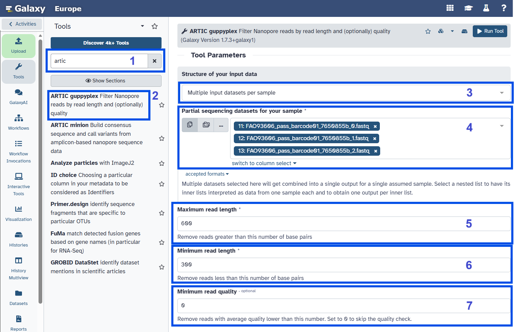</p>

#### **2.2.2. NanoPlot**

Now we will run NanoPlot on the reads filtered by length after running ARTIC, with the objective of plotting post-processed reads (NanoPlot can also apply filters based on quality and length, but this time we will use it only for plotting purposes, since we have already filtered based on these criteria):

1. Search for the **Nanoplot** tool and select **NanoPlot - Plotting suite for Oxford Nanopore sequencing data and alignments**
2. Run the tool as follows:
    - In the *files* part, select the **ARTIC output file** (ARTIC guppyplex on data set XX - XX).
    - Display **Options for customizing the plots created**:
        - **Specify the bivariate format of the plots** > _Select all_
        - **Show the N50 mark in the read length histogram** > _Yes_
3. Select **Run Tool**. An HTML report will be generated along with the corresponding statistics.

<p align="center">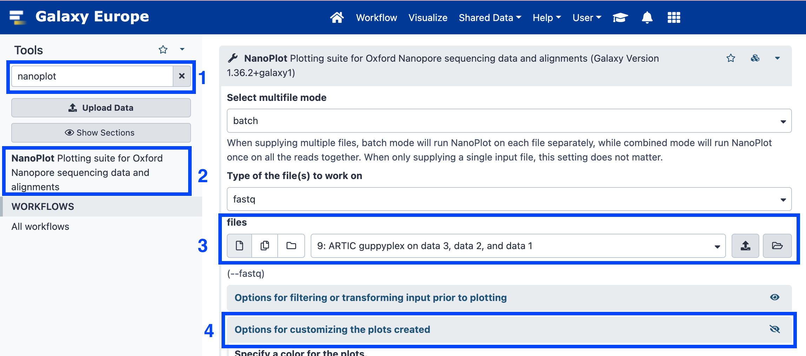</p>
<p align="center">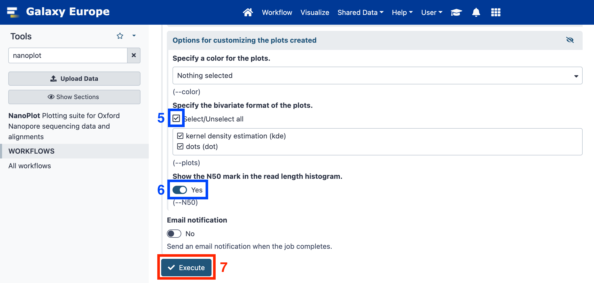</p>

**Questions**
<details>
<summary>Did our data length and quality improve?</summary>
<b>Yes, now we have reads within the length and quality specified.</b>
</details>

<details>
<summary>How many reads did we lose during the trimming step?</summary>
<b>137 reads (3000 - 2863)</b>
</details>
<br>

>**This hands-on history URL**: [**https://usegalaxy.eu/u/svarona/h/nanopore-quality**](https://usegalaxy.eu/u/s.varona/h/nanopore-quality).
