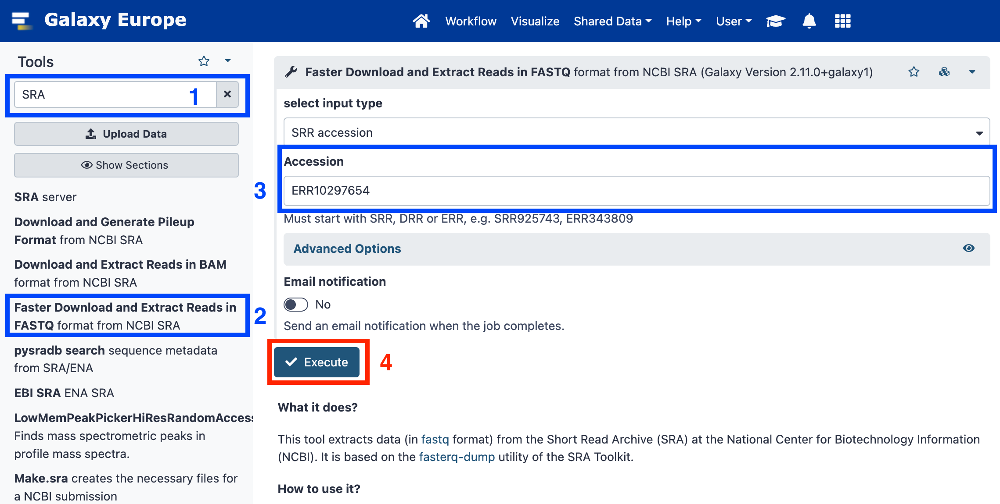
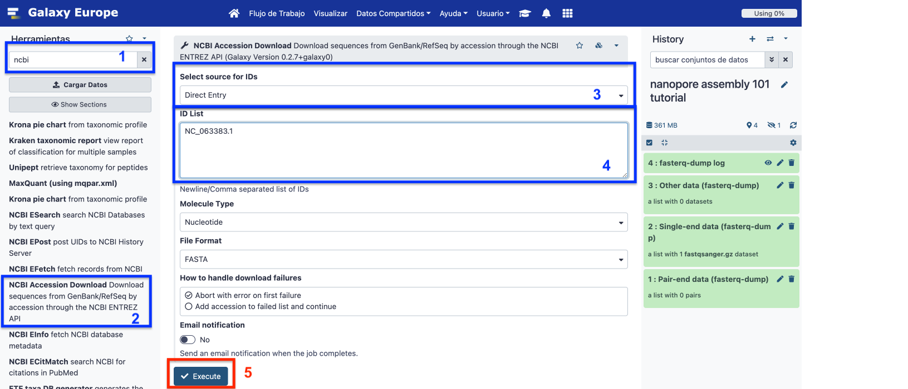
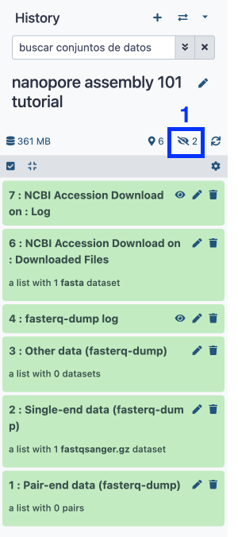
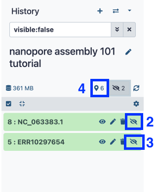
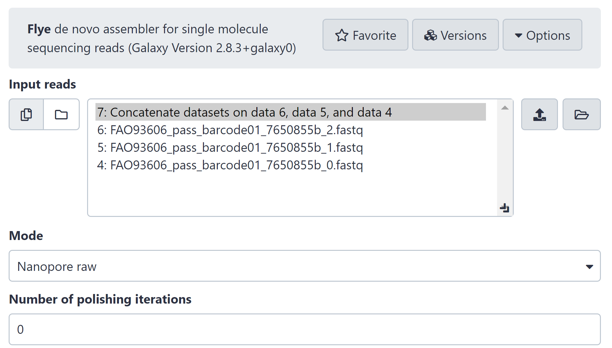
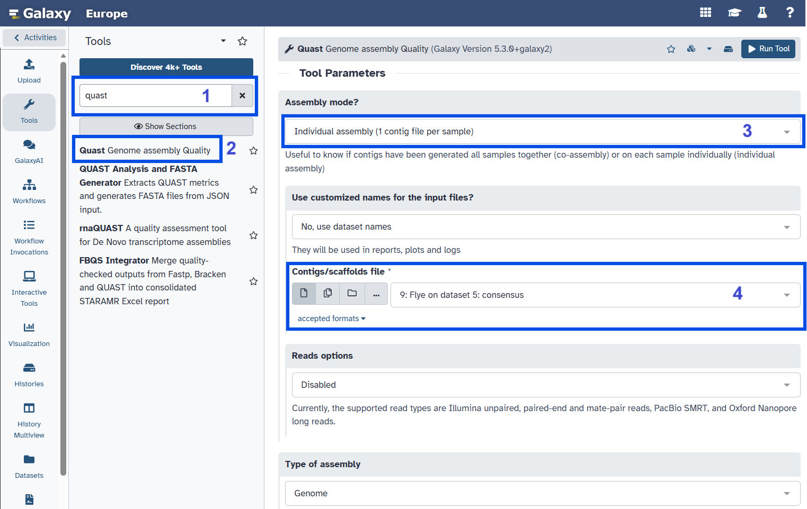
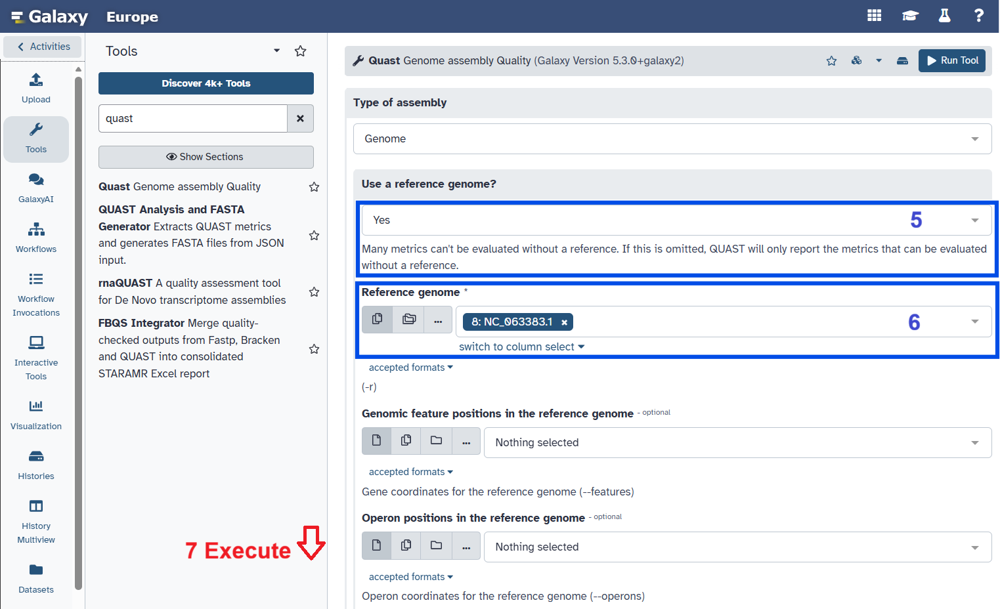
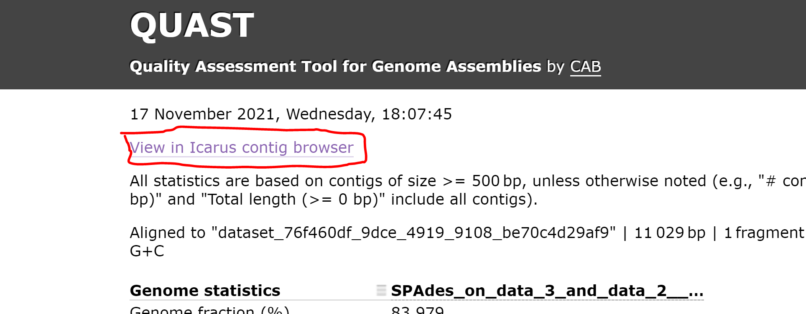
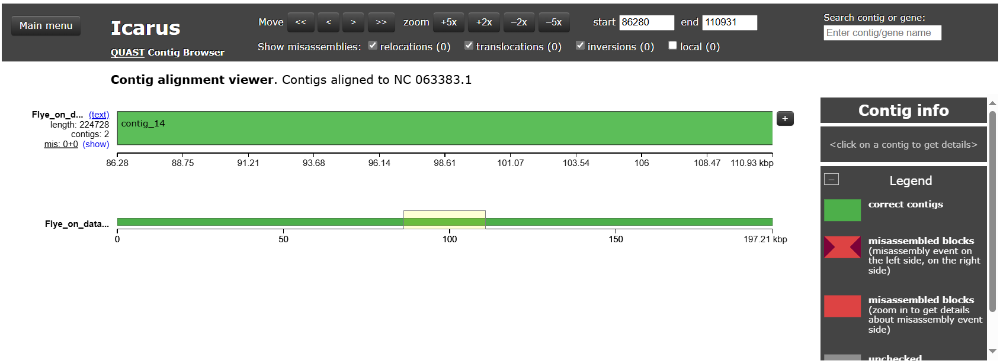

# Analysis of viral genomes using the Galaxy platform
# **Exercise 4: Nanopore Assembly**

|**Title**| Galaxy |
|---------|-------------------------------------------|
|**Training dataset:**|  Nanopore MinION Sequencing of a Monkey Pox Virus (MPXV) from Spain 2022 oubreak. Data is publicly available at SRA with the ID [**ERR10297654**](https://trace.ncbi.nlm.nih.gov/Traces/?view=run_browser&acc=ERR10297654&display=metadata). You can check the paper [**here**](https://pubmed.ncbi.nlm.nih.gov/38637500/).
|**Questions:**| <ul><li>How different are Nanopore reads assembled in comparison to Illumina reads?</li></ul>|
|**Objectives**:|<ul><li>Understand the concept of assembly.</li><li>Learn how to interpret assembly quality control metrics with Nanopore data.</li></ul>|
|**Estimated time**:| 40 min |

## **1. Description**

Oxford Nanopore sequencing is a third-generation sequencing technology capable of generating much longer reads than Illumina. However, read length and accuracy depend on library preparation, sequencing chemistry and basecalling methods. Each platform has distinct technical biases, which must be considered when choosing an analysis workflow.

In this tutorial, we will explore *de novo* assembly using Nanopore reads.

## **2. Upload data to Galaxy**

### **Training dataset**

- SRA ID: [**ERR10297654**](https://trace.ncbi.nlm.nih.gov/Traces/?view=run_browser&acc=ERR10297654&display=metadata).

### **Create new history**

- Click on the `+` icon at the top of the history panel and create a new history with the name `Nanopore assembly` as explained [**here**](https://github.com/BU-ISCIII/galaxy_virologist_training/blob/one_week_format/exercises/01_introduction_to_galaxy.md#2-galaxys-history).

### **Upload data**

1. Look for `SRA` in the tool search bar and select `Faster Download and Extract Reads in FASTQ format from NCBI SRA`.
2. Accession = `ERR10297654`.
3. Run Tool.

### **Load reference file from NCBI**

1. Search `NCBI` using the search toolbox and select `NCBI Accession Download Download sequences from GenBank/RefSeq by accession through the NCBI ENTREZ API`.
2. Select source for IDs > **Direct entry**.
3. ID List = **NC_063383.1**
4. Run Tool.

### **Unhide data**

Using SRA and NCBI API downloads data as hidden, so we will now unhide this data as follows:
1. Click on the **strikethrough eye** (Show hidden).
2. Select the strikethrough for ERR10297654 and NC_063383.1 data.
3. Then select the location icon (show active).

## **3. Assemble reads with Flye**

1. Search for the `Flye` assembler using the search toolbox and select `Flye - de novo assembler for single molecule sequencing reads`.
2. Input reads: **ERR10297654**.
3. Click on Run Tool and wait.

**Flye** will generate four output files:
- **Consensus**: final assembly (FASTA) with the contig sequences, to be used for the subsequent assembly quality analysis with QUAST.
- **Assembly graph**: assembly graph in ``graph_dot`` format.
- **Graphical fragment assembly**: the same graph in GFA format, including the sequences of each segment. It can be opened for example in Bandage to inspect the assembly structure.
- **Assembly info**: tab-delimited table with per-contig statistics: length, coverage, etc.

## **4. Assembly quality control with QUAST**

1. Search QUAST in the search tool box.
2. **Assembly mode? > Individual assembly**.
3. Contigs/scaffolds file > **Flye results**.
4. Use a reference genome: **Yes**. Select the **NC_063383.1 FASTA file** previously loaded.
5. Run Tool.

6. Click on the eye icon from the **QUAST HTML report**.
    

    
How much of our reference genome have we reconstructed?

    <b>Genome fraction: 100</b>
    

    

    
How many contigs do we have greater than 1000 pb?

    <b>17</b>
    

    

    
How long is the largest contig in the assembly?

    <b>199259 (this can vary +-10 nucleotides).</b>
    

    

    
Which is the N50?

    <b>199259 (length of the largest contig in this case).</b>
    

7. Open the **Icarus** viewer in the QUAST report.

 
Which contig aligns completely against our reference genome?

 <b>Contig 14 aligned correctly (this can vary, it should correspond to the number of the largest contig).</b>
 

 

>**This training history is available at: https://usegalaxy.eu/u/s.varona/h/nanopore-assembly-101-tutorial**

>[!note]
Nanopore data is known to have a higher error rate than short sequencing reads. This is why assembly post-processing is strongly recommended, usually using combined sequencing aproximation with both Nanopore and Illumina reads (hybrid assembly).
